# Sirkit PCB Placement and Routing Technical Audit

**Audit date:** 2026-07-16  
**Audited commit:** `2bd1603a775bd4b409b89710cd4e5f8d70201632`  
**Audit tree:** safety copy at `C:\Users\robsa\Documents\Codex\2026-07-13\do\work\sirkit-edit`  
**Production changes:** none. Two temporary diagnostic scripts were removed after use.  
**FreeRouting runtime observed:** bundled FreeRouting 2.2.4 with bundled Java; no API key required.

## 1. Executive summary

Sirkit has a real, mostly backend-grounded PCB pipeline. Schematic connectivity is converted into deterministic PCB nets, footprints are placed by a seeded force-directed placer plus rotation and collision post-processing, the manual router validates geometric clearance, and the autorouter exports DSN to a local FreeRouting process, imports SES, reconstructs connectivity, runs DRC, and commits only a validated candidate as one undoable transaction. Four physical copper layers are represented throughout storage, rendering, connectivity, DRC, KiCad export, and native manufacturing output. These are substantial strengths.

The audit also found three immediate data-integrity blockers:

1. Schematic synchronization preserves existing copper by numeric `netId`, but rebuilt net IDs can change when a net is added or renamed. A track on `B` can therefore silently become a track on `A`.
2. Footprint resolution validates only pad count, not the actual schematic pin-number set. A symbol with pins `1,3` can accept a footprint with pads `1,2`; the missing node is then omitted from DSN.
3. Manual stretch and rip-up paths do not honor locked copper. A locked route can be moved or removed.

Placement crowding is not caused by a missing spacing setting. The requested 1.15 virtual placement envelope is implemented and does not affect manufacturing geometry. Crowding persists because the optimization model is intentionally coarse: all pads on a net produce a complete spring graph, high-fanout power nets create many attractive forces, and routeability is estimated from straight-airwire crossings, four short axis-aligned pad corridors, and a simple via-demand formula. It has no routing-channel capacity, layer-capacity, differential-pair, decoupling, high-current-loop, thermal, or RF model. The crowded fixture reached legal non-overlap but retained 42 predicted crossings and only reduced estimated wire length by 12.3%.

Incomplete autorouting has multiple distinct causes. FreeRouting can return a genuinely partial route. Separately, Sirkit rejects an entire pass if it introduces physical DRC errors, which safely prevents bad copper from being committed but can turn a 30/30 engine result into 0/30 visible progress. In the crowded fixture, pass 1 reached 30/30 but was rejected for five new DRC errors; pass 2 reached 27/30 and was rejected for seven. At least one observed error was a false integration mismatch: Sirkit applied minimum clearance between two tracks on the **same** `3V3` net, whereas FreeRouting's clearance model permits same-net copper to approach or join.

Multilayer signal routing works in controlled cases: the forced two-layer test used both `F.Cu` and `B.Cu` with two vias and completed 2/2 connections; the all-signal four-layer test imported routes on `In1.Cu` and `In2.Cu` and completed 2/2. However, the current public model cannot express per-net layer restrictions needed to force ordinary tracks onto every one of four layers. Signal/plane boards are fragile: stackup plane polygons are exported to DSN, but they are configuration, not filled `Zone` copper in the board connectivity model. Consequently Sirkit cannot count those planes as conductive after SES import. The signal/plane fixture also produced a zero-byte SES with process exit code 0; `parseSes()` marked it unsuccessful, but the autoroute API does not enforce `wasSuccessful`.

The first investigation priority should therefore be correctness at boundaries, not new optimization: stable net identity during sync, exact symbol-pin/footprint-pad parity, locked-copper invariants, same-net DRC semantics, unsuccessful/empty SES rejection, and one consistent representation of plane conductivity. The optimization limitations should be addressed only after those boundaries are trustworthy.

## 2. Scope and method

The audit traced source entry points, data structures, tests, and runtime behavior without modifying production code. Controlled diagnostic fixtures covered:

- a connector/resistor/LED two-layer board;
- the repository's forced two-layer-via verification;
- the repository's four-layer multilayer verification;
- a signal/plane four-layer board;
- a 16-footprint crowded MCU-style board with 30 required connections;
- two isolated schematic-sync correctness reproductions.

The user's live browser board was not available to the Node audit process and no exported project JSON was supplied. The crowded MCU story fixture was used instead. Therefore findings about the current user board are not claimed as observed facts.

Runtime logs and the existing autoroute debug bundle were written only under the operating-system temporary directory. FreeRouting is nondeterministic in the crowded case: a direct run completed 28/30 while the API's first run completed 30/30 before its candidate was rejected. Quantitative results below identify the particular observed run and are not presented as universal benchmarks.

## 3. End-to-end architecture

```mermaid
flowchart LR
  S["SchematicState"] --> C["buildNetUnionFind()<br/>app/lib/connectivity"]
  C --> N["buildNetlist()<br/>netlist-bridge.ts"]
  N --> SY["syncFromSchematic()<br/>PcbBoard nets + padNets"]
  SY --> PL["initial placement / autoPlace()<br/>PcbBoard footprints"]
  PL --> B["PcbBoard + PcbHistory"]
  B --> DS["boardToDsn() / writeDsn()<br/>DsnBoard + DSN text"]
  DS --> FR["runFreerouting()<br/>local Java process"]
  FR --> SE["parseSes()<br/>tracks + vias"]
  SE --> CA["build candidate + preserve protected copper"]
  CA --> CO["computeConnectivity()<br/>BoardConnectivity"]
  CO --> DR["runDrc()<br/>DrcResult + readiness"]
  DR --> VE["verifyAutorouteCandidate()<br/>AutorouteVerification"]
  VE --> CM["history.execute(AutorouteImport)<br/>one undoable commit"]
  B --> AI["buildPcbAiSnapshot() / PCBToolService<br/>provider-neutral tools"]
  AI --> PL
  AI --> DS
  AI --> DR
```



### 3.1 Schematic-to-PCB call trace

```text
PcbEditor.handleSync()
→ warm footprint/part cache
→ syncFromSchematic(board, schematic, getPart)
→ buildNetlist(schematic, getPart)
→ buildNetUnionFind(schematic)
→ same-name root merge and deterministic net numbering
→ resolveFootprint() and padNets assignment
→ centeredImportPositions() or layoutStagingStrip()
→ remap existing copper by numeric netId
→ history.execute("Sync schematic to PCB", replaceBoardContents)
→ browser-local project persistence
```

Evidence: `app/components/pcb/PcbEditor.tsx` (`handleSync`, `replaceBoardContents`), `app/lib/pcb/netlist-bridge.ts` (`buildNetlist`, `resolveFootprint`, `centeredImportPositions`, `layoutStagingStrip`, `syncFromSchematic`), `app/lib/connectivity`, and `app/lib/pcb/board-persistence.ts`.

### 3.2 Auto-place call trace

```text
PcbToolbar / PcbEditor
→ useAutoPlace.run()
→ worker-backed autoPlace(board, options)
→ buildPlacementEnvelope() for each movable footprint
→ optional generated-outline expansion to 110%
→ runCandidate() for seeded candidates
   → runForceDirected()
   → optimizeRotations()
   → resolveCollisions()
   → analyzePlacementRouteability()
   → computeRatsnest()
→ choose lowest routeability score, then shortest ratsnest
→ stale-revision and cancellation gates
→ one PcbHistory transaction
```

Evidence: `app/components/pcb/hooks/useAutoPlace.ts`, `app/lib/pcb/autoplace/auto-place.ts`, `envelope.ts`, `force-directed.ts`, `rotation.ts`, `collision-resolver.ts`, and `routeability.ts`.

### 3.3 Autoroute call trace

```text
PcbToolbar / Ctrl+E
→ PcbEditor
→ useAutoroute.run()
→ POST /api/pcb/autoroute
→ resolve bundled local runtime
→ completeAutoroute()
→ boardToDsn() → validateDsn() → writeDsn()
→ runFreerouting() Java process
→ parseSes()
→ candidate board + protected-copper restoration
→ verifyAutorouteCandidate()
→ runDrc() + computeConnectivity()
→ retry incomplete nets at greater effort when allowed
→ client stale-revision gate
→ history.execute(AutorouteImport) as one undoable transaction
```

Evidence: `app/components/pcb/hooks/useAutoroute.ts`, `app/api/pcb/autoroute/route.ts`, `app/lib/pcb/autoroute/completion.ts`, `runner.ts`, `verification.ts`, and `app/lib/pcb/dsn/{write-dsn,preflight,read-ses}.ts`.

## 4. Core data and electrical definitions

The canonical engineering object is `PcbBoard` in `app/lib/pcb/types.ts`. It holds stackup/profile data, nets and rules, footprint instances and `padNets`, tracks, vias, zones, keepouts, and placement/routing preferences. Geometry is stored in integer nanometres. Rendering and AI snapshots convert as needed; the AI snapshot exposes millimetres.

Sirkit decides two pads belong to the same required electrical net when schematic union-find roots are merged and both component-pin nodes map to the same generated net. `buildNetlist()` merges roots that carry the same net label and applies name precedence `ground > power > generic`. Named nets are sorted alphabetically for IDs; unnamed nets follow stable node keys. Unnamed singleton nodes are dropped; named singleton nodes are retained.

Definitions proven from `app/lib/pcb/connectivity-board.ts` and `app/lib/pcb/autoroute/verification.ts`:

| Term | Current exact meaning |
|---|---|
| Required connection | For a net with `p` assigned pads, `max(0, p - 1)`. |
| Completed connection | Required connections minus `(pad-containing conductive clusters - 1)`. |
| Unrouted connection | One fewer than the number of pad-containing conductive clusters; materialized as cluster-MST airwires. |
| Incomplete net | A net whose assigned pads occupy more than one conductive cluster. DRC emits one error object per incomplete net. |
| Dangling/orphan copper | A net-0 track/via or copper touching no compatible item, reported as a warning. |
| Short | Geometrically touching conductive items with different nonzero net IDs. |
| Conductive item | Pad, track, via across its spanned layers, or a **filled** zone region. An empty/dirty zone outline and stackup plane declaration are not conductive. |
| Complete autoroute | Zero remaining required connections, no shorts, and no route-blocking errors after candidate verification. |

Connectivity is geometric plus graph-based. `computeConnectivity()` builds per-layer spatial indexes, unions same-net shapes at zero or negative shape distance, unions vias across their span, then derives clusters and airwires. It is a full reconstruction on each call, not an incremental graph. `computeRatsnest()` is a separate pad-only Prim minimum-spanning tree and can be limited to changed nets by its caller.

### 4.1 Boundary-decision pseudocode

The following condensed pseudocode records the remaining decisions that are spread across several modules.

```text
overlap detection / resolution:
  order locked footprints first, then stable footprint ID
  transform each virtual placement envelope to world bounds
  if candidate intersects an already placed bound:
    try up to 8 directed nudges, clipped to board and snapped to 0.1 mm
    else search grid rings 1..50 with radius multipliers 1, 8, then 32
  after placement, recompute all overlap pairs
  autoPlace success requires overlapPairs == 0

congestion estimation:
  airwires = pad MST or cluster-aware connectivity airwires
  crossings = intersections between straight airwires of different nets
  blockedEscapes = pads whose four 1.25 mm axial corridors hit an envelope
  estimatedVias = crossings + floor(totalAirwireLength / 30 mm)
  score = 1000*overlaps + 1000*outside + 500*padsOutside
        + 100*blockedEscapes + 10*crossings + length/10 mm

via-rule export:
  for each resolved net class:
    choose its width/clearance and named via padstack
  for each via padstack:
    emit circular copper shape on every enabled physical copper layer
  allow first-enabled → last-enabled transition
  preflight verifies positive size/drill/ring and transition reachability

FreeRouting invocation:
  write pass DSN and target SES temp paths
  spawn bundled Java + bundled FreeRouting JAR in headless mode
  pass input/output, design rules, and max-pass arguments
  enforce cancel/timeout and inspect process exit
  read SES text; process success is currently not parse success

SES layer mapping:
  parse session resolution and route S-expressions
  exact layer name → enabled LayerId through current stackup
  unknown/disabled layer → throw
  polyline edges → individual tracks with imported width/net
  known via padstack → full first-to-last enabled layer via

connectivity reconstruction:
  materialize pads, tracks, vias, and filled-zone regions per layer
  spatially query possibly touching pairs
  if same nonzero net and shapeDistance <= 0: union graph nodes
  if different nonzero nets and touching: record short
  union each via across all spanned layers
  group pad-containing roots per net
  remainingConnections = max(0, padContainingRoots - 1)

autoroute candidate decision:
  verify connectivity and DRC on candidate
  reject if a previously complete net becomes incomplete
  reject if new shorts appear
  reject if new physical DRC error IDs appear
  accept only if connectivity or DRC improves without those regressions
  complete only when remainingConnections == 0
    and shorts == 0 and routeBlockingErrors == 0

DRC readiness decision:
  run full geometric, manufacturing, zone, and connectivity checks
  errors = violations where severity == error
  unrouted = sum of remaining pad-cluster connections
  state = ready only when errors == 0 and unrouted == 0
  note: one incomplete-net error can represent many unrouted connections
```

## 5. Algorithm inventory

| Subsystem | Algorithm or heuristic | File/function | Purpose and I/O | Constraints/settings | Deterministic? | Failure mode and coverage |
|---|---|---|---|---|---|---|
| Schematic connectivity | Union-find plus same-label root merge | `app/lib/connectivity`, `netlist-bridge.ts:buildNetlist` | `SchematicState` → component-pin nets | Label priority; drops unnamed singletons | Yes for same input | Missing pin/pad identity checks; covered by `netlist-bridge.test.ts`, not ID-drift regression |
| Initial import | Shelf/staging-strip packing, then rigid centering and ring spreading | `netlist-bridge.ts:layoutStagingStrip`, `centeredImportPositions` | New footprint bounds → initial positions | 2 mm gaps, 50 mm rows, 1 mm search rings up to 60 | Yes | Can remain staged or crowded; basic sync tests only |
| Placement envelope | Source selection + uniform scale + routing margin union | `autoplace/envelope.ts:buildPlacementEnvelope` | footprint definition/rules → virtual BBox | default scale 1.15; via/pad/manufacturer margins | Yes | Conservative/fallback boxes; strong unit coverage |
| Global placement | Seeded damped force-directed simulation | `force-directed.ts:runForceDirected` | movable envelopes + net graph + board → positions | 400 iterations; spring K 0.02; rest 5 mm; repulsion `4e14`; damping .85; max 2 mm step | Yes, seeded | May converge to route-poor local minimum; covered by force and auto-place tests |
| Placement candidate search | Small deterministic random restart | `auto-place.ts:runCandidate`, `autoPlace` | board → up to 2 candidates by default, max 4 | choose routeability then ratsnest | Yes | Narrow search space; tested |
| Rotation | Greedy independent 0/90/180/270 pad-distance score | `rotation.ts:optimizeRotations` | candidate positions → rotations | honors allowed rotations and locked state | Yes | No coupled/local search after rotation; tested |
| Overlap removal | Ordered clipping/nudging plus grid BFS | `collision-resolver.ts:resolveCollisions` | envelopes → legal positions | 0.1 mm grid; max 8 nudges; rings 50; multipliers 1/8/32 | Yes | Throws for impossible size; crowded unresolved result is rejected; tested |
| Placement routeability | Weighted geometric proxy | `routeability.ts:analyzePlacementRouteability` | board/envelopes/airwires → cost/report | overlap 1000; outside 1000; pads outside 500; blocked escape 100; crossing 10; length/10 mm | Yes | Does not model actual routing capacity; unit and story tests |
| Ratsnest | Prim MST over pad points per net | `ratsnest.ts:computeRatsnest` | pad positions → airwires | pad-only Euclidean metric | Yes | Does not account for existing copper; board connectivity supplies copper-aware airwires elsewhere; tested |
| Manual posture | Two octilinear candidates | `route-tool.ts`, smart-routing modules | pointer endpoints → H/V/45 segments | grid 25 µm; preferred posture | Yes | No arbitrary angle; tested |
| Manual walk-around | Inflated obstacle boxes + corner graph + Dijkstra/CW/CCW search | smart-routing modules | endpoints/obstacles → candidate polyline | bounded geometric search | Yes | No shove or springback; `smart-routing.test.ts` |
| Live route validation | Segment geometry and clearance checks | `route-tool.ts` | candidate segments → legal/block reason | endpoint, 45°, self-crossing, edge, keepout, clearance | Yes | Same-net clearance semantic mismatch affects DRC reuse; route/DRC tests |
| Board connectivity | Spatial broad phase + union-find | `connectivity-board.ts:computeConnectivity` | board copper → clusters, shorts, airwires | layer-aware, exact geometry | Yes | Stackup planes absent unless represented as filled zones; extensive tests |
| DSN structural export | Deterministic board transform | `dsn/write-dsn.ts:boardToDsn` | `PcbBoard` → `DsnBoard` | stackup roles, classes, full-span via padstacks, protected wiring | Yes | Does not emit drill in via padstack; tested for 2L/4L |
| DSN serialization | S-expression writer | `dsn/write-dsn.ts:writeDsn` | `DsnBoard` → text | µm coordinates; escaped names | Yes | Some footprint shapes simplified; tests |
| FreeRouting | External high-effort maze/rip-up router | `autoroute/runner.ts:runFreerouting` | DSN → SES | pass count, via/fanout/postroute costs; max total 290 s | Not reliably | Can return partial or empty SES; integration and runtime tests |
| Autoroute retry | Incomplete-net pass controller | `autoroute/completion.ts:completeAutoroute` | board/pass results → best safe candidate | global 5, per-net 3, no-improvement 2; effort scaling | Deterministic controller; engine is not | Rejects whole unsafe pass; completion tests |
| SES import | S-expression walk and strict layer/net mapping | `dsn/read-ses.ts:parseSes` | SES → tracks, vias, usage | mapped enabled layers; known nets/padstacks; full-span vias | Yes | Unsuccessful result can be ignored by API; tests lack route-level empty SES gate |
| DRC | Full batch checker suite | `drc/run-drc.ts:runDrc` | board + fab rules → violations/readiness | containment, layers, clearance, widths, vias, holes, courtyards, silk, connectivity, zones | Yes | Not incremental; extensive unit tests, boundary gaps below |
| AI planning | Provider-neutral tool-calling loop | `api/pcb/repair/agent/route.ts` | request/snapshot/tools → repair plan | 8 iterations; 23 allowed planning tools | Provider-dependent | Server cannot mutate directly; repair tests |
| AI mutation | Preview/validate/apply transaction service | `ai/pcb-tool-service.ts:PCBToolService` | approved candidate → history mutation | stale revision, DRC, connectivity, approval gates | Yes for native operations | Semantic revision omits some engineering fields; repair/history tests |

## 6. Schematic-to-PCB synchronization analysis

### 6.1 Identity and mapping

Theory components receive reference designators from array order and type counters; KiCad instances retain their supplied `id` and `refDes`. `resolveFootprint()` resolves an assigned or library footprint and currently accepts it when `padCount === component.pins.length`. It does not compare the sets of pin and pad numbers. `padNets` is keyed by schematic pin number.

`syncFromSchematic()` rebuilds the net array. Existing footprints keep position, rotation, and side. New parts default to rotation 0 and top side. Existing tracks, vias, and zones pass through a local `remapNet(netId)` that only preserves an ID if that same integer is still present in the rebuilt net list. It does not map old net identity/name to the new ID.

There is no PCB-to-schematic back-annotation call path. PCB and schematic are persisted together in browser local storage, but PCB placement or routing edits do not alter schematic identity or coordinates. No duplicate-reference validator was found in sync or DSN preflight. Differential-pair recognition is not implemented; it is listed as post-MVP. Net-class assignment in `netclass-rules.ts` is name/topology based (`HighCurrent`, power/ground patterns, and IC power-pin topology).

### 6.2 Initial placement

Schematic drawing coordinates do not influence PCB coordinates. `layoutStagingStrip()` uses footprint geometry in 50 mm rows with 2 mm gaps, initially left of the board. `centeredImportPositions()` translates this group to the board center and searches 1 mm rings, up to 60, for overlaps with retained components. The search uses footprint body/courtyard bounds rather than the full routing-aware 1.15 envelope. If explicit coordinate preservation is selected, new items remain in the staging strip.

Connectors, mechanical parts, and edge connectors are not given semantic initial placement. In auto-place, `locked`, `fixedPosition`, `mechanical`, and `edgeConnector` footprints are simply immovable. In particular, `edgeConnector` does not mean “place on an edge”; it means “do not move.”

## 7. Placement analysis

### 7.1 Envelope and spacing pseudocode

```text
selectPlacementEnvelopeSource(definition):
  if valid courtyard contains pads: source = courtyard
  else if valid body contains pads: source = body
  else if pads or graphics exist: source = union(pads, graphics)
  else: source = 2 mm × 2 mm fallback

buildPlacementEnvelope(instance, definition, rules, scale=1.15):
  base = selected local bounds transformed for rotation/side
  scaled = scale about center by 1.15
  routingMargin = max(
    0.50 mm via landing,
    0.25 mm manufacturer margin,
    trackWidth/2 + clearance,
    viaSize/2 + clearance,
    courtyard clearance)
  effective = union(scaled, expand(base, routingMargin))
  return virtual effective bounds
```

This is a virtual placement envelope only. `placement-envelope.test.ts` proves that changing or building placement envelopes does not change DSN/manufacturing geometry.

### 7.2 Force and cost model

`runForceDirected()` seeds off-board movable footprints on a grid with deterministic ±1 mm jitter. Every pair of footprints sharing a net receives a spring, so a `k`-footprint net produces `k(k-1)/2` attractive pairs. Multiple shared nets add multiple spring relationships. All footprint pairs also receive repulsion with an approximately 20 mm broad cutoff, while boundaries are soft forces during simulation. Rotation and hard collision resolution happen after the force stage.

Approximate runtime is `O(iterations × n² + sum(net fanout²))`, plus collision search. Candidate count is two by default. This explains why high-fanout `GND` and power networks can pull many parts toward a common MCU region even though overlap resolution later makes the result geometrically legal.

The reported routeability score is:

```text
1000 × overlapPairs
+ 1000 × outsideFootprints
+ 500 × padsOutside
+ 100 × blockedPadEscapes
+ 10 × straightAirwireCrossings
+ ratsnestLength / 10 mm
```

Pad escape tests only four axis-aligned corridors of length 1.25 mm against conservative boxes. Estimated via demand is `crossings + floor(ratsnestLength / 30 mm)`. These are proxies, not a router or heatmap based on channel capacity.

### 7.3 Constraint coverage

| Placement concern | Status | Enforcement |
|---|---|---|
| Footprint overlap | Implemented | Hard success gate after collision resolver |
| Courtyard/body spacing | Implemented through virtual envelope | Hard overlap gate; source-dependent |
| 1.15 scale | Implemented, default | Virtual only; not user-facing in main workflow |
| Board boundary and pads inside | Implemented | Hard result gate |
| Locked/fixed/mechanical/edge connector | Implemented | Immovable hard constraint |
| Ratsnest length/crossings | Implemented | Soft candidate score |
| Pad escape | Partially implemented | Four short axial corridors; hard success gate for reported failures |
| Via landing | Approximate | Envelope margin and via-demand estimate |
| Keepouts | Present in board routing/DRC, not a complete placement-channel model | Partial |
| Routing-channel capacity/parallel tracks | Not implemented | — |
| Layer count/capacity | Not used by placement cost | — |
| High-density fanout | Indirect through complete spring graph; no fanout model | Soft and potentially crowding |
| Plane access | Not implemented in placement | — |
| Differential pairs | Not implemented | — |
| Decoupling/high-current/thermal/RF objectives | Not implemented | — |

AI can inspect routeability, preview/apply placement, and run local placement through `PCBToolService`. The server LLM planning pass does not receive mutation tools; actual mutation is performed locally only after candidate creation and gates.

### 7.4 Placement fixture metrics

| Metric | Simple LED before | Simple LED after | Crowded MCU before | Crowded MCU after |
|---|---:|---:|---:|---:|
| Board area | 384 mm² | 384 mm² | 1200 mm² | 1452 mm² after 1.10 outline expansion |
| Inflated envelope area | 35.463 mm² | same | 442.813 mm² | same |
| Packing density | 9.24% | 9.24% | 36.90% | 30.50% |
| Outside footprints | 3 | 0 | 16 | 0 |
| Assigned pads outside | 6 | 0 | 41 | 0 |
| Overlap pairs | not material | 0 | 3 | 0 |
| Blocked pads | — | 0 | — | 0 under current four-corridor test |
| Minimum effective-envelope gap | — | 0.146 mm | — | 0.026 mm |
| Average effective-envelope gap | — | 1.179 mm | — | 5.401 mm |
| Straight airwire crossings | — | 0 | 48 | 42 |
| Estimated ratsnest length | 16.472 mm | 12.296 mm | 303.073 mm | 265.895 mm |
| Congestion score | 6611.65 | 1.23 | 44110.31 | 446.59 (`Medium`) |
| Force iterations / time | — | 62 / 14 ms | — | 131 / 75 ms |

The crowded result is legally spaced by the implemented envelope checks, yet remains difficult to route. This is a model-quality limitation, not evidence that the 1.15 inflation is absent.

## 8. Manual and local routing analysis

| Feature | Status | Evidence and behavior |
|---|---|---|
| Start from pad | Implemented | Starts on copper pad; inherits its net |
| Start from track | Partial | Only a track endpoint, not arbitrary segment point |
| Grid snap | Implemented | 25 µm otherwise; same-net pad can override |
| 45° posture | Implemented | Two direct octilinear postures |
| Arbitrary angle | Not implemented | Validator accepts H/V/45 only |
| Walk-around | Implemented | Inflated obstacle boxes and bounded graph search |
| Shove/springback | Not implemented | No neighboring-copper displacement solver |
| Live clearance/edge/keepout | Implemented | Candidate validator blocks illegal preview |
| Via insertion | Implemented for simple switching | `V` inserts a via and flips layer |
| Four-layer layer selection | Incorrect/partial | `flipCopperLayer()` maps top→bottom and every other layer→top |
| Target completion | Partial | Same-net pad snap; not general same-net track/via/zone snap |
| Wrong-net prevention | Mostly implemented | Foreign copper blocks; exact completion snaps only same net; net-0 start is allowed |
| Segment simplification | Implemented in candidate path | Polyline normalized/validated |
| Pullback | Backspace uses command/history behavior | Multi-click connection is not necessarily one transaction |
| Undo/redo | Implemented | Each route click/via is a command; smart candidate polyline is atomic |
| Locked copper | Incorrect | Stretch and net rip-up do not filter locked items |

The manual router is a single-layer local walk-around router with a top/bottom via toggle, not a multilayer pathfinder. Starting on an inner layer and pressing `V` can construct an inner-to-top span, while DRC currently permits only full through-vias and reports unsupported spans. `buildRipupNetCommand()` removes all copper for the chosen net, and the stretch hit/mutation path does not check `locked`.

New manual tracks/vias usually omit an explicit `source`; protection code treats undefined as non-generated, so autoroute preservation currently works, but provenance is ambiguous.

## 9. FreeRouting integration and routing analysis

### 9.1 Runtime and pass controller

`runFreerouting()` invokes the bundled Java/JAR headlessly with GUI, API, file logging, and interactive console disabled; console level is WARN. It supplies input/output files and a maximum pass count. The child receives a small environment allowlist, supports cancellation/timeout termination, and temporary cleanup. The total controller budget is approximately 290 seconds.

High-effort passes enable vias, fanout, and post-route optimization and adjust via/rip-up costs. `completeAutoroute()` defaults to up to five global passes, three net retries, and two no-improvement passes; engine effort scales roughly 1.0/1.5/2.0 and is capped. Later passes select incomplete nets and remove only unlocked generated/autorouter copper on those targets. Human/imported/locked copper is restored by exact geometry before verification.

There is no genuine engine progress stream; the UI can show elapsed time but not current pass/net progress. A process exit code of zero means only that the process exited, not that routing completed. Completion is independently calculated after import.

### 9.2 DSN export pseudocode and representative excerpts

```text
boardToDsn(board, optional target nets):
  resolve stackup profile and enabled physical copper layers
  emit each layer in physical order with signal/power role and direction
  emit board boundary and keepouts
  emit per-instance images with absolute pad positions baked at origin
  emit network nodes and net classes
  emit full-span via padstacks and class via rules
  emit existing copper as protected wiring
  emit full-board plane polygons for assigned plane layers
```

Representative two-layer policy:

```lisp
(layer F.Cu (type signal))
(layer B.Cu (type signal))
(rule (width 250) (clearance 200))
```

Both layers are active; `F.Cu` prefers horizontal and `B.Cu` vertical. Default/power/high-current classes receive their resolved widths and via padstack names.

Representative signal/plane four-layer structure observed:

```lisp
(layer F.Cu   (type signal))
(layer In1.Cu (type power))
(layer In2.Cu (type power))
(layer B.Cu   (type signal))
...
(plane "GND"  (polygon In1.Cu ...))
(plane "+3V3" (polygon In2.Cu ...))
```

The active routing policy is on/off/off/on for these layers. The all-signal profile is on/on/on/on with alternating preferred directions.

DSN uses the selected stackup, not UI visibility or active layer. It supports nm/µm conversion and exports exact circle pads; rectangle/roundrect/oval are simplified to rectangles and arbitrary-angle rectangles remain nominal axis-aligned. Existing copper is marked protected. Pad world positions are baked into per-instance image geometry at origin, avoiding a second rotation/mirror transform.

`DsnVia` contains `drillNm` and preflight validates it, but `writeDsn()` emits only copper circles for the via padstack, not a drill/hole clause. Imported vias recover known size/drill from the padstack name, so this did not block the controlled through-via test, but the interchange description is incomplete.

### 9.3 Stackup profiles

| Profile | Physical layers and roles | Routing directions/widths | Plane nets and via policy |
|---|---|---|---|
| Simple 2-layer | `F.Cu` signal, `B.Cu` signal | horizontal 0.25 mm; vertical 0.25 mm | Full through-vias |
| Signal/plane 4-layer | F signal, In1 plane, In2 plane, B signal | F horizontal 0.25; B vertical 0.25; planes inactive | In1 inferred GND, In2 power; full F-to-B via padstacks |
| All-signal 4-layer | F, In1, In2, B all signal | H/V/H/V; 0.25/0.20/0.20/0.25 mm | Full through-vias |
| Dense 4-layer | all signal | H/V/H/V; 0.20/0.18/0.18/0.20 mm | Fanout enabled; full through-vias |

Blind and buried vias are not supported by current DRC/manufacturing policy. `viaSpannedLayers()` can describe spans, but containment DRC accepts only full through spans.

### 9.4 SES import and downstream use

`parseSes()` maps `F.Cu`, `In1.Cu`, `In2.Cu`, and `B.Cu` through the board's selected stackup. Unknown or disabled layers throw; there is no fallback to `F.Cu`. Polylines split into track segments, widths and coordinates are scaled, net names must match exactly, and via geometry is recovered from known padstack names. Imported vias are represented as first-enabled to last-enabled full through-vias.

Supported units are nm, µm, mm, mil, and inch. An unknown unit currently silently falls back to a scale of one nanometre, creating a coordinate-corruption risk. Duplicate segments are not deduplicated; explicit arc import was not found. `passesRun` remains `-1` because the SES parser has no pass metadata.

Inner-layer tracks survive the full downstream path:

```text
parseSes layer ID
→ PcbBoard.track.layer
→ renderer and layer controls
→ computeConnectivity per-layer index
→ DRC physical-layer validation
→ kicad/write-pcb.ts layer mapping
→ fab/native/mir.ts copperTop/in1/in2/copperBottom
→ Gerber/native manufacturing geometry
```

### 9.5 Runtime routing results

| Fixture | Required/completed | Layer usage | Vias | Runtime | DRC/result |
|---|---:|---|---:|---:|---|
| Simple LED 2L | 3/3 | 6 top segments | 0 | 2.856 s | 0 DRC errors |
| Forced crossing 2L | 2/2 | both F and B | 2 | 2.951 s | 0 DRC errors |
| All-signal 4L verification | 2/2 | one 30 mm `In1`, one 30 mm `In2` segment | 0 | 3.384 s | Complete |
| Crowded direct engine run | 28/30 | top: 109 segments/237.993 mm; bottom: 17/89.239 mm | 5 | 8.512 s | 1 clearance error + 2 incomplete-net errors |
| Crowded API completion | final accepted 0/30 | rejected pass 1: 30/30; rejected pass 2: 27/30 | last parsed 6 | 15.371 s | Both passes rejected for 5 and 7 new DRC errors |
| Signal/plane 4L | 0/3 | none | 0 | 2.883 s | Exit 0, zero-byte SES, parser unsuccessful |

The all-signal fixture proves storage/import/connectivity on inner layers, but it does not force all four layers. Sirkit has no public per-net layer constraint, so the requested “at least one route on every layer” fixture cannot presently be expressed without constructing a non-public DSN. This is recorded as a testability gap, not as proof that F/B fail.

### 9.6 Why partial or zero visible progress occurs

There are four separate states:

1. FreeRouting may genuinely leave connections incomplete.
2. FreeRouting may produce a complete candidate that Sirkit rejects for new shorts or physical DRC errors.
3. A later pass may regress a previously complete net and be rejected.
4. The process may exit 0 without a usable SES; the current API can treat the non-throwing unsuccessful parse as a pass.

The crowded API run demonstrated state 2: 30/30 was routed in pass 1, but the entire candidate was rejected. This behavior protects the board; it also discards safe portions of a mixed-quality candidate and makes the final board appear unchanged.

## 10. Multilayer and plane analysis

“Layer use” must be reported by more than ordinary track length:

- signal-layer use: track segments/length, pads, and via transitions;
- plane-layer use: conductive plane/zone area and pad/via access, even with zero tracks;
- via use: transition graph across physical layers;
- pad use: layer-specific SMD or through-hole copper connection.

`AutorouteSetup.tsx` currently reports a layer as `unused` when its track `layerUsage` is absent. The main layer panel similarly emphasizes segment count. Therefore a plane with a DSN polygon and no ordinary tracks is misleadingly presented as unused.

The deeper issue is electrical representation. The signal/plane stackup profile causes `boardToDsn()` to generate boundary-sized DSN plane polygons. Those polygons are not inserted into `PcbBoard.zones` with a computed fill. `computeConnectivity()` only treats `Zone.fill.regions` as conductive. After SES import, Sirkit therefore has no native conductive object corresponding to the FreeRouting plane declaration. Even if FreeRouting considers a pad or via attached to that plane, Sirkit cannot reconstruct that attachment and will report the net incomplete.

The signal/plane experiment had a second failure: FreeRouting exited 0 and wrote a zero-byte SES. The exact engine-side cause is unknown because no diagnostic stderr was produced. DSN preflight itself passed and showed four enabled layers, two routable signal layers, two assigned plane layers, and legal full-span via transitions. The plane-model mismatch is confirmed from code; the zero-byte engine cause remains a hypothesis requiring stronger FreeRouting logging or a minimal upstream reproduction.

## 11. Connectivity, DRC, and readiness

### 11.1 Checker pipeline

`runDrc()` performs a full connectivity reconstruction and then batch checks:

- board/footprint/pad/track/via containment;
- physical layer validity and supported via span;
- copper, edge, and hole clearances;
- minimum track width, via size, drill, and annular ring;
- courtyard overlap and silkscreen rules;
- incomplete nets, shorts, and orphan copper;
- zone-fill validity.

It can be aborted between stages but is not incremental. Fabrication readiness is `not-ready` when blocking errors or unrouted connections remain. Schematic parity is a separate value passed into AI/readiness snapshots; `unknown` does not currently block the AI snapshot's fabrication-readiness flag.

### 11.2 Why error count can be low with many unrouted connections

`drc/checks/connectivity.ts` emits one `incompleteNet` violation per net, storing that net's remaining-connection count in the violation. Readiness separately sums airwires/cluster deficits. Thus 11 incomplete-net DRC objects can represent 30 unrouted required connections. The crowded board before routing exhibited exactly this: 11 blocking error objects and 30 remaining connections.

### 11.3 Same-net clearance mismatch

`drc/checks/clearance.ts` reuses `checkClearance()` from `route-tool.ts`. Its separation predicate reports a violation whenever `0 < distance < required clearance`, including items with the same net ID. FreeRouting applies clearance between different nets and allows same-net shapes to approach or meet. In the direct crowded run, tracks `ar-t-…-56` and `ar-t-…-57` were both on `3V3`, measured 0.048 mm apart against a 0.127 mm threshold, and Sirkit's diagnostic incorrectly said “between copper on different nets.” This mismatch can reject otherwise electrically valid FreeRouting output.

### 11.4 False-clean and false-complete assessment

- No path was found that declares an incomplete pad-cluster graph electrically complete.
- A filled zone is counted; an unfilled/dirty outline is correctly not counted.
- A stackup plane declaration is not counted at all, producing false-incomplete signal/plane results rather than false-complete results.
- Missing symbol pins caused by bad footprint mapping can be absent from DSN and PCB pad connectivity, allowing the reduced PCB model to look cleaner than the schematic intent. That is a false-clean boundary failure.
- `parseSes().wasSuccessful === false` can be ignored, allowing HTTP 200 partial output for an unusable session. It does not falsely report full completion in the observed case, but it misclassifies pipeline health.

## 12. AI PCB control analysis

### 12.1 State and tools

`buildPcbAiSnapshot()` in `app/lib/pcb/ai/snapshot.ts` emits schema `sirkit.ai-pcb.v1` with exact millimetre coordinates; physical stackup layers including hidden layers; footprints, virtual placement envelopes and pads; nets/rules; track/via provenance and locks; zones and keepouts; connectivity; DRC; placement analysis; event history; and readiness.

`PCB_AI_TOOLS` in `pcb-tool-schemas.ts` contains 44 provider-neutral tool schemas shared by OpenAI and Anthropic. The repair-agent endpoint permits 23 read/planning tools. The remaining native service catalog includes placement preview/apply, DRC repair preview/apply/undo, bounded autoroute/reroute/rip-up, local placement optimization, zone refill, transaction verification, and seven UI-view-only actions.

There are no standalone AI tools named “set track width” or “change via type.” Such edits may appear inside a validated generic repair plan, but the server LLM cannot directly execute them. The repair endpoint's system prompt and allowlist explicitly prevent mutation in the server planning pass.

| AI capability | Status |
|---|---|
| Read full board/exact coordinates/all physical layers | Implemented |
| Inspect DRC/connectivity/congestion/pad access | Implemented |
| Preview placement and repairs | Implemented in native service |
| Apply placement/repair | Implemented with candidate/approval/stale gates |
| Invoke bounded autoroute/reroute/rip-up | Implemented as preview, with generated-copper protection |
| Refill zones/run DRC/verify connectivity | Implemented |
| Move/rotate components | Through placement/repair candidates, not arbitrary direct server mutation |
| Direct track-width/via-type tool | Not implemented |
| Undo transaction | Implemented for matching recent transaction |
| DOM selectors/screenshots for engineering decisions | Not used by PCB service |
| Direct database writes | Not used; local `PcbHistory`/board state |
| UI clicks required | Only ordinary user approval/workflow and view adapter actions; engineering services are callable without clicking DOM elements |

### 12.2 Safety and history

`PcbHistory` in `history.ts` uses Immer patches, retains up to 200 entries, and records append-only engineering events with actor, reason, affected objects, and transaction IDs, including undo/redo. Autoroute and repair apply as bounded transactions; stale board revisions and regression checks gate mutation.

`pcbRevisionId()` is not fully semantic. Its digest includes stackup, stackup config, outline, footprint/pad geometry and assignments, copper, zones, keepouts, rules, and placement preferences, but omits at least the board `nets` array and routing preferences. A net-name-only or routing-policy-only edit may therefore leave the revision unchanged, allowing a stale AI/autoroute candidate to pass the revision gate despite changed engineering intent.

## 13. Confirmed problems

### C-01 — Existing copper can silently change nets after schematic sync

- **Evidence:** Isolated runtime reproduction: old nets `B(id=1), C(id=2)` with a human track on ID 1. Adding alphabetically earlier `A` rebuilt nets as `A(id=1), B(id=2), C(id=3)`; the track remained ID 1 and became `A`.
- **Root cause:** `syncFromSchematic()` rebuilds deterministic numeric IDs, while `remapNet()` preserves the integer rather than mapping old stable net identity/name to new identity.
- **Affected:** `app/lib/pcb/netlist-bridge.ts:buildNetlist`, `syncFromSchematic`.
- **Consequence:** Silent electrical corruption of tracks, vias, and zones after routine schematic edits.
- **Severity:** **P0 — correctness/data loss**.
- **Reproduce:** Route net `B`; sync; add named net `A`; sync; inspect track net name.

### C-02 — Pin-count-only footprint acceptance drops unmatched schematic pins

- **Evidence:** A two-pin symbol numbered `1,3` accepted a footprint with pads `1,2`; `padNets` contained key `3`, while DSN emitted only one physical node for the affected net. Preflight produced only a singleton warning.
- **Root cause:** `resolveFootprint()` compares counts but not exact pin/pad-number sets; DSN can only emit physical pads that exist.
- **Affected:** `app/lib/pcb/netlist-bridge.ts:resolveFootprint`, `dsn/write-dsn.ts:boardToDsn`, `dsn/preflight.ts:validateDsn`.
- **Consequence:** Schematic connectivity disappears from the routable PCB model and can appear falsely clean.
- **Severity:** **P0 — correctness/data loss**.
- **Reproduce:** Assign a `1,2` two-pad footprint to a `1,3` two-pin symbol and sync/export.

### C-03 — Locked manual copper can be stretched or ripped up

- **Evidence:** Track hit/stretch code has no `locked` filter; `buildRipupNetCommand()` selects all tracks/vias on the net.
- **Root cause:** Manual edit command selection does not enforce the same protected-copper invariant as autoroute.
- **Affected:** `app/lib/pcb/route-tool.ts` stretch and rip-up handlers; `route-tool.commands.ts:buildRipupNetCommand`.
- **Consequence:** User-locked/imported routing can be moved or deleted.
- **Severity:** **P0 — correctness/data loss**.
- **Reproduce:** Mark a route locked; drag a track endpoint or invoke rip-up on its net.

### C-04 — Duplicate reference designators are not rejected at the sync/export boundary

- **Evidence:** No duplicate-reference validation is present in `buildNetlist`, `syncFromSchematic`, or `validateDsn`; DSN component/pin references depend on reference strings.
- **Root cause:** Reference uniqueness is assumed upstream.
- **Affected:** `netlist-bridge.ts`, `dsn/write-dsn.ts`, `dsn/preflight.ts`.
- **Consequence:** Ambiguous component/pin identity and potentially invalid interchange.
- **Severity:** **P0 — correctness risk**.
- **Reproduce:** Import two schematic instances with the same reference and inspect generated DSN component/pin keys.

### C-05 — Plane declarations are not conductive in Sirkit's post-route board model

- **Evidence:** `boardToDsn()` synthesizes plane polygons from stackup assignment; `computeConnectivity()` only consumes `Zone.fill.regions`. No corresponding board zone/fill is created during SES import.
- **Root cause:** Plane intent exists in stackup/DSN but not as native conductive geometry.
- **Affected:** `stackup.ts`, `dsn/write-dsn.ts:boardToDsn`, `dsn/read-ses.ts:parseSes`, `connectivity-board.ts:computeConnectivity`.
- **Consequence:** GND/power plane connections remain reported as unrouted; readiness cannot validate plane boards.
- **Severity:** **P1 — routing completion**.
- **Reproduce:** Signal/plane 4L board with two GND and two power pads; export/route/import; reconstruct connectivity without filled zones.

### C-06 — Same-net clearance semantics can reject valid FreeRouting copper

- **Evidence:** Observed two `3V3` tracks 0.048 mm apart flagged against 0.127 mm; message falsely asserted different nets. API rejected complete/near-complete candidates with new DRC errors.
- **Root cause:** DRC reuses a route clearance predicate that applies separation to same-net disjoint copper.
- **Affected:** `drc/checks/clearance.ts`, `route-tool.ts:checkClearance`, autoroute candidate gate.
- **Consequence:** Engine completion can become zero visible progress.
- **Severity:** **P1 — routing completion**.
- **Reproduce:** Import two close, same-net FreeRouting segments and run DRC.

### C-07 — Empty/unsuccessful SES is not enforced as an autoroute failure

- **Evidence:** Signal/plane run exited 0 with a zero-byte SES; `parseSes()` returned `wasSuccessful:false`, zero tracks/vias. API logic consumes the result without checking this flag and can return HTTP 200 partial.
- **Root cause:** Runner checks process/file read; API catches thrown parser errors but not the parser's non-throwing unsuccessful result.
- **Affected:** `autoroute/runner.ts:runFreerouting`, `dsn/read-ses.ts:parseSes`, `api/pcb/autoroute/route.ts`.
- **Consequence:** Process/parse failure is misreported as a legitimate partial route and may trigger useless retries.
- **Severity:** **P1 — routing completion**.
- **Reproduce:** Supply an empty SES with process success or use the observed signal/plane fixture.

### C-08 — Manual layer toggle is not four-layer aware

- **Evidence:** `flipCopperLayer()` returns bottom for top and top for every other layer.
- **Root cause:** Binary top/bottom switching logic remained after four-layer support.
- **Affected:** `app/lib/pcb/route-tool.ts:flipCopperLayer`.
- **Consequence:** Users cannot deliberately route through all layers; inner-layer start can create a span rejected by DRC.
- **Severity:** **P1 — routing completion**.
- **Reproduce:** Start on `In1.Cu`, press `V`, and inspect via span/next layer.

### C-09 — Semantic revision omits net and routing-policy changes

- **Evidence:** `pcbRevisionId()` digest payload omits `board.nets` and routing preferences.
- **Root cause:** Stale-safety hash covers geometry and many rules but not all engineering intent.
- **Affected:** `app/lib/pcb/ai/snapshot.ts:pcbRevisionId` and consumers in AI/autoroute preview gates.
- **Consequence:** A candidate calculated for old net names/classification or routing policy may remain apparently current.
- **Severity:** **P1 — correctness/routing**.
- **Reproduce:** Record revision, rename only a net or change only routing preferences, recompute revision.

### C-10 — Autoroute debug statistics can describe a different candidate from the returned board

- **Evidence:** Crowded API response returned the original accepted board with no layer usage but reported `tracksImported:130`, `viasImported:6` from the last rejected parse. Debug bundle combined last DSN/SES with best accepted candidate verification.
- **Root cause:** Last-engine-pass parse metrics and best-accepted-candidate state share one response/bundle.
- **Affected:** `api/pcb/autoroute/route.ts`, debug bundle assembly.
- **Consequence:** Engineers cannot reliably locate whether routes were lost at engine, import, verification, or rejection.
- **Severity:** **P3 — observability**.
- **Reproduce:** Force a routed pass to be rejected; compare response stats, returned routes, and debug SES.

### C-11 — Plane layers are labelled unused when they have no tracks

- **Evidence:** `AutorouteSetup.tsx` bases `unused` on track `layerUsage`; stackup plane polygons/zones are not included.
- **Root cause:** UI equates layer use with ordinary track length.
- **Affected:** `app/components/pcb/AutorouteSetup.tsx` and layer usage summaries.
- **Consequence:** Misleading multilayer diagnostics.
- **Severity:** **P3 — usability/observability**.
- **Reproduce:** Select signal/plane profile with assigned plane nets and zero ordinary inner tracks.

### C-12 — Unknown SES units silently use a one-nanometre scale

- **Evidence:** Unit resolver in `read-ses.ts` defaults unknown unit text instead of rejecting it.
- **Root cause:** Permissive fallback in parser.
- **Affected:** `app/lib/pcb/dsn/read-ses.ts`.
- **Consequence:** Malformed/external SES can import grossly scaled geometry without a clear parse error.
- **Severity:** **P1 — interchange correctness**.
- **Reproduce:** Change the SES resolution unit token to an unsupported name and parse.

## 14. Hypotheses and unknowns

| Unknown | What is known | Missing evidence / verification |
|---|---|---|
| Why FreeRouting wrote zero-byte SES for signal/plane fixture | DSN preflight passed; Java exited 0; no stderr; planes/layers were emitted | Run minimal DSN in FreeRouting GUI/verbose mode, capture internal board/rule diagnostics, compare with an upstream known-good plane DSN |
| User's current failing board | Browser-local state was inaccessible to Node audit | Export project/board JSON plus schematic; replay through the same diagnostic harness |
| Forced use of all four signal layers | Inner-layer import is proven; no public per-net layer restrictions exist | Add a test-only DSN fixture with explicit layer constraints or a public constraint model, then assert F/In1/In2/B usage |
| Whether every rejected crowded DRC error is same-net false-positive | One direct-run violation is proven; API rejected pass reports five/seven but bundle state is mixed | Persist per-pass candidate DRC with net IDs and correlate each rejected object to its DSN/SES |
| FreeRouting nondeterminism source | Identical logical crowded board produced 28/30 and 30/30 on separate runs | Capture exact DSN hashes, engine seed/thread settings, and full stdout for repeated controlled runs |
| Back-side asymmetric footprint transform fidelity in DSN | Tests cover common side/rotation cases | Round-trip asymmetric polygon/oval pads at every rotation and back-side mirror through an independent oracle |
| Arc behavior in external SES | No explicit arc importer was found | Supply known SES arc syntax and assert either exact import or explicit rejection |

## 15. Test and observability gaps

The repository already has broad unit coverage for placement, geometry, history, connectivity, DRC, DSN, SES, multilayer mapping, KiCad/native fabrication, routing, and repair planning. The important missing boundary tests are:

1. Sync regression proving existing copper remains on the same **stable named net** after net insertion, deletion, and rename.
2. Exact symbol-pin/footprint-pad-number parity, duplicate references, duplicate pad numbers, and “every schematic connection survived DSN” assertions.
3. Locked-track stretch and locked-net rip-up invariants.
4. Same-net DRC clearance parity between manual validation, native DRC, and FreeRouting rules.
5. Empty/whitespace/partial SES plus `wasSuccessful` integration gates.
6. Signal/plane end-to-end connectivity with explicit native conductive plane representation.
7. A forced four-layer fixture that requires ordinary routes on F/In1/In2/B, not merely inner layers.
8. Repeated deterministic FreeRouting runs or an explicit record of engine nondeterminism.
9. Per-pass artifacts tying one DSN, command, stdout/stderr, SES, parsed candidate, connectivity result, DRC result, and acceptance decision to the same pass ID.
10. Revision-ID tests for net rename, net-class change, routing preference, stackup plane assignment, and other non-geometric engineering changes.
11. SES unknown-unit, duplicate-segment, arc, malformed-layer, and partial-file tests at the API boundary.
12. Placement benchmarks comparing actual autoroute completion/DRC against proxy score over a fixed corpus.
13. User-board replay support from an exported project artifact.

Current autoroute observability lacks engine progress, per-net route decisions, seed/thread information, and reliably paired best-vs-last artifacts. The diagnostic bundle should be treated cautiously until each pass is self-contained.

## 16. Prioritized findings

### P0 — correctness/data loss

1. Numeric net-ID drift silently reassigns existing copper during schematic sync (`C-01`).
2. Pin-count-only footprint validation can drop schematic connections (`C-02`).
3. Locked copper is mutable through manual stretch/rip-up (`C-03`).
4. Duplicate reference identity is not validated (`C-04`).

### P1 — routing completion and interchange correctness

1. Plane declarations do not exist in native connectivity after SES (`C-05`).
2. Same-net clearance mismatch rejects FreeRouting candidates (`C-06`).
3. Empty/unsuccessful SES is not treated as a failed pass (`C-07`).
4. Manual layer switching is binary on four-layer boards (`C-08`).
5. Revision hashing omits nets/routing policy (`C-09`).
6. Unknown SES units silently corrupt scale (`C-12`).

### P2 — placement quality

1. Complete-graph springs on high-fanout nets encourage central crowding.
2. Routeability lacks channel/layer capacity, parallel-track, fanout, plane-access, differential-pair, decoupling, high-current, thermal, and RF models.
3. Candidate search is only two deterministic restarts by default and does not use actual autoroute/DRC feedback.
4. Initial import spreading uses simpler footprint bounds than auto-placement's routing envelope.

### P3 — usability and observability

1. Last-pass stats/debug artifacts can disagree with the returned best candidate (`C-10`).
2. Plane layers are shown as unused when they have no tracks (`C-11`).
3. No real FreeRouting progress or stable engine seed is exposed.
4. Rejected all-or-nothing passes explain no visible progress but do not identify which subset was valid.
5. `passesRun:-1` and ambiguous manual-route provenance reduce diagnostic value.

### P4 — optimization opportunities, not immediate blockers

1. Differential-pair routing and class recognition.
2. Shove/springback and arbitrary-angle interactive routing.
3. Per-net layer constraints and deliberate four-layer utilization.
4. Blind/buried via policy when manufacturing support exists.
5. Actual route-capacity/thermal/current-aware placement optimization.

## 17. Smallest questions before a redesign specification

1. Can the failing project be exported as Sirkit project/board JSON with its matching schematic so the exact user board can be replayed?
2. Should signal/plane profiles represent planes as ordinary persisted filled zones, or is there another intended native electrical object that has not yet been connected to `computeConnectivity()`?
3. Is same-net copper intentionally exempt from clearance except for explicit same-net spacing rules? FreeRouting and standard PCB semantics imply yes, but the product rule should be stated.
4. Which identity is authoritative across schematic sync: a stable schematic net UUID, normalized net name, or another immutable key?
5. Must manual `V` cycle through every enabled signal layer, or should layer selection be explicit in the UI?

Until these are answered, implementation work should be limited to the proven correctness blockers above; broad placement or routing redesign would risk optimizing against corrupted or unverifiable boundary data.
