# Sirkit Stage 10 Incremental Verification, Collaboration, and Persistence

Date: 2026-07-17  
Branch: `codex/stage-10-incremental-collaboration`  
Protected working copy: `C:\Users\robsa\Documents\Codex\2026-07-13\do\work\sirkit-edit`  
Specification SHA-256: `BBBC21E97B9B49FB711F0CB82B05A780D9AA46309E2A5B513C0C5D2CB95F518E`

The original `C:\Users\robsa\sirkit` tree was not modified.

## 1. Executive implementation summary

Stage 10 now has a tested foundation for semantic engineering transactions, domain revision vectors, exact object/change impact, dependency-driven synchronous invalidation, revision-bound scheduling, full-oracle shadow comparison, immutable hash-chained records, atomic Node file persistence, atomic browser IndexedDB persistence, deterministic migration validation, conservative collaboration conflicts/rebase, proposal review, per-actor inverse transactions, least-privilege actor authorization, privacy-minimized telemetry, explicit saved/synced/verified states, circuit breakers, and a governed 36-scenario corpus.

The safe rollout remains at Phase 2 shadow mode. Existing UI/API/AI/import mutation paths still use legacy history/localStorage paths, affected connectivity and every DRC checker still use full fallback, and no production server/transport/offline collaboration system was cut over. This is intentionally not declared complete.

## 2. Stage 1-9 prerequisite evidence

| Stage | Verified usable contract | Gap affecting Stage 10 |
|---|---|---|
| 1 | Stable PCB IDs, protection, atomic candidates, semantic PCB revision v2 | Not every project/schematic mutation uses one semantic transaction service. |
| 2 | Deterministic full electrical truth is a differential oracle | No deletion-capable affected-component incremental graph yet. |
| 3 | Ready/blocked/incomplete/stale and waiver separation | Evidence records are not yet all registered in the Stage 10 dependency graph. |
| 4 | Revision-bound zones, stale-fill rejection, same-net policy | Refill remains full; incremental downstream contact insertion is not implemented. |
| 5 | Pinned atomic records/content evidence exist | Main component selection/upgrade paths remain legacy/incomplete. |
| 6 | Typed deterministic constraint compiler exists | Full authoring/consumer migration is incomplete; incremental selector compilation absent. |
| 7 | Atomic placement candidates and routeability metrics exist | Candidate adapters and scale correlation remain incomplete. |
| 8 | Atomic route candidates, topology, locks, revisions and stale rejection exist | Advanced pair/shove/tuning contracts remain incomplete. |
| 9 | Governed corpus, immutable results, oracles, metrics and regression gates exist | Stage 9 itself is incomplete: no licensed-real corpus/full flow/meaningful held-out optimization. |

The missing Stage 9 breadth prevents a complete Stage 10 equivalence/performance proof, but it does not prevent building the compatible shadow-mode foundation. Therefore the verdict is `STAGE 10 INCOMPLETE`, not `BLOCKED BY STAGE 9`.

## 3. Fresh audited-baseline reproduction

| Area | Current source/current behavior | Stage 10 after behavior | Test/status |
|---|---|---|---|
| Connectivity | `electrical-truth.ts` calls full `computeConnectivity()` | Full remains authoritative; canonical differential digest/fallback added | Full fallback only; incomplete |
| DRC | `drc/run-drc.ts` runs nine full stages | Every current DRC kind has a dependency/full-fallback descriptor | No incremental checkers; incomplete |
| Readiness | Broad full reports in `readiness/*` | Synchronous derived-artifact invalidation and explicit pending status | Product readiness not wired; partial |
| Revision | `pcb/revision.ts` covers nets/routing preferences and PCB truth | Project revision vector adds 11 domain digests plus ordered head | Tested |
| History | `pcb/history.ts` keeps 200 Immer entries/events | Semantic operations and durable inverse operations exist separately | Legacy paths remain; partial |
| Persistence | `lib/persistence.ts` stores whole JSON in localStorage; several catches suppress errors | Provider-neutral store plus IndexedDB/atomic file implementations | Not cut over; partial |
| Candidates/workers | Multiple subsystem-specific stale gates | Pinned job envelope, coalescing, cancellation and result acceptance | Not adopted by all workers; partial |
| Zone fill | Dirty/current state with full refill | Semantic copper/placement edits dirty affected zones before publication | Refill full-only; partial |
| Constraints | Full deterministic compiler/evaluator | Domain dependencies registered | Incremental compiler absent |
| Collaboration | No authoritative shared protocol | Conservative in-process authoritative session/conflicts/proposals/undo | No transport/server deployment |
| Assets | Atomic content evidence exists | Required content-digest asset pins in project envelope | Main asset paths not migrated |

Foundation benchmark, Windows/Node v24.15.0/Intel Core Ultra 5 125U:

- full electrical truth: 30 samples, p50 5.617 ms, p95 12.869 ms, max 16.592 ms;
- full DRC: 30 samples, p50 7.081 ms, p95 11.226 ms, max 26.616 ms;
- semantic commit plus synchronous invalidation: 20 samples, p50 10.359 ms, p95 12.159 ms, max 14.800 ms.

These are baseline measurements, not an incremental speedup claim.

## 4. Mutation and derived-state inventory

Existing mutation entry points include schematic editing/sync, PCB edit commands/history, selection/move, routing, zones, placement, autoroute import, repair, constraint endpoints, component selection, project import/migration, AI tools and direct localStorage helpers. Existing derived consumers include electrical truth, ratsnest, zones, DRC, constraints, route/placement analysis, readiness, fabrication/export, AI snapshots and UI summaries.

Migrated foundation operations: footprint move/protection; track add/update/remove; via add/update/remove; zone add/update/remove; board outline; routing preferences; net update; asset pin/remove. Remaining bypasses are all existing UI/API/AI/import/history paths because broad cutover without complete adapters and differential proof would be unsafe. `PcbHistory` patches remain implementation history, never represented as collaborative intent.

## 5. Final architecture

```mermaid
flowchart LR
  A["UI / API / AI / Import actor"] --> B["Authorize semantic transaction"]
  B --> C["Check base and object versions"]
  C --> D["Apply candidate and derive exact change set"]
  D --> E["Validate invariants"]
  E --> F["Atomic snapshot + log + head commit"]
  F --> G["Synchronous dependency invalidation"]
  G --> H["Publish accepted head"]
  H --> I["Revision-bound scheduler"]
  I --> J["Full oracle / future incremental evaluator"]
  J --> K{"Equivalent?"}
  K -- Yes --> L["Current evidence"]
  K -- No --> M["Divergence + circuit breaker + full fallback"]
```



Canonical state contains PCB, opaque existing schematic state and pinned asset manifest. Derived artifacts are disposable/revision-bound. Ephemeral presence/UI state is excluded. `EngineeringTransactionService` owns authorization, preconditions, semantic operation application, change-set derivation, durable commit and invalidation. The dependency graph and scheduler remain separate from persistence. Collaboration submits transactions, never snapshots or patches.

## 6. Semantic operation registry

All implemented operations use schema v1, integer nanometres, stable IDs, optional expected object version, role capability, deterministic validation, exact inverse construction, change-set impact and durable serialization.

| Operations | Capability | Inverse/conflict policy |
|---|---|---|
| Move footprint | `edit_placement` | Restore prior position/rotation/side; protected object blocks; same object conflicts |
| Set footprint protection | `manage_protection` | Restore prior lock; AI directly forbidden |
| Add/update/remove track | `edit_copper` | Remove/restore/restore fields; locked blocks; net/topology interaction conflicts |
| Add/update/remove via | `edit_copper` | Remove/restore/restore fields; exact span and size validation |
| Add/update/remove zone | `edit_zones` | Remove/restore/restore fields; fill immediately dirty |
| Board outline | `edit_stackup_outline` | Restore prior outline; broad physical conflict |
| Routing preferences | `edit_constraints` currently | Restore prior preferences; domain-wide invalidation |
| Net update | `edit_constraints` currently | Restore name/endpoints; net/routing conflict |
| Pin/remove asset | `edit_components` | Remove/restore; required asset cannot be removed; AI directly forbidden |

Missing operations include schematic/hierarchy, component binding upgrade, constraints/waivers, stackup, full candidates, imports, restore/migrate and manufacturing release flows.

## 7. Dependency and invalidation matrix

| Source change | Immediately affected artifacts | Current evaluator |
|---|---|---|
| Schematic/electrical intent | electrical truth, DRC, readiness, AI snapshot | Full fallback |
| Component binding/geometry | electrical truth, constraints, DRC, placement, readiness | Full fallback |
| Track/via topology | zones, electrical truth, DRC, measurements, readiness | Full fallback |
| Zone/fill | zone fill, electrical truth, DRC, readiness | Full fallback |
| Stackup | zones, electrical, constraints, DRC, measurements, preflight/readiness | Full fallback |
| Constraints/classification | constraints, zones, electrical/DRC, analyses, readiness | Full fallback |
| Outline/placement | DRC, placement, preflight/readiness | Full fallback |
| Waiver | readiness presentation only | Full readiness |
| Asset revision | constraints/geometry/analyses/preflight/readiness | Full fallback |
| Protection | candidate policy and readiness dependents | Semantic transaction gate |

Invalidation is transitive, evaluator-versioned, acyclic and synchronous. Cached historical values may remain only with `pending` status; they cannot be presented as current.

## 8. Incremental connectivity design

The Stage 2 full electrical model remains the oracle and canonical output is normalized by stable net, terminal, cluster, short, orphan and airwire semantics. The Stage 10 change set supplies affected nets, topology IDs, layers and old/new bounds.

A true deletion-capable physical/logical incremental graph was not implemented. Additions, deletions, bridge splits, via layer disconnects and zone contact changes all use `broad_full_fallback`. This avoids a false union-find delete implementation. Cluster lineage, affected-component recomputation, spatial contact index updates and scale equivalence remain required.

## 9. Incremental DRC design

Eight descriptors cover every current `DrcCheckKind`: containment/layers, copper/edge clearance, track width, via geometry, hole spacing, courtyard, silkscreen and electrical connectivity. Descriptors declare dependencies, full evaluator, stable issue policy, semantic comparator, priority and full fallback.

Every descriptor is explicitly `not_trusted` for incremental use with a zero-object fallback threshold. No selective DRC read is enabled. Old/new region queries, rule-aware pair indexes and issue lifecycle storage remain unimplemented.

## 10. Incremental constraint/evidence design

Constraint, placement, route measurement, manufacturing preflight, readiness and AI snapshot artifacts have dependency descriptors and synchronous pending states. Constraint selector indexes, partial compilation, measurement-local updates, exact evidence-item dependencies and waiver lineage integration are not implemented. Full Stage 3/6/7/8 evaluators remain the safe path.

## 11. Scheduler and worker contract

Jobs pin project/branch, complete revision vector, evaluator ID/version, artifact kind/scope, change set, input digests, priority, seed and cancellation token. New work for the same artifact/scope cancels and replaces prior work with a distinct job identity. Results are rejected for unknown job, cancellation, stale head or evaluator/schema mismatch. Queue capacity is bounded. Existing placement, autorouter, zone and AI workers are not yet migrated to this scheduler.

## 12. Persistence architecture

`AtomicProjectStore` supports load, initialize, commit, backup and restore. Each envelope contains canonical snapshot, ordered semantic log, head revision, assets, migrations and integrity manifest.

- Node adapter: exclusive writer lock, fsynced temporary file, atomic rename and SHA-256 file wrapper.
- Browser adapter: one strict IndexedDB read-write transaction for snapshot/log/head.
- In-memory adapter: deterministic tests and fault injection.
- Idempotency: durable client-operation key scan returns the original accepted record.
- Integrity: snapshot/log/envelope digests plus previous-record hash chain.

Not implemented: server database/object store, checkpoints/compaction, retained backup schedule, quota UX, asset blob store, encryption and deployed disaster recovery.

## 13. Migration report

The legacy migration wrapper runs deterministic electrical-identity and constraint migration, records a pre/post physical/electrical signature, blocks semantic divergence, rejects future schemas and emits a migration history record. It honestly starts the semantic log at the migration envelope; it does not invent meaning for old Immer patches.

Production localStorage-to-IndexedDB migration, interruption at every migration phase, read-only future-client behavior, downgrade policy and large real project matrix remain unimplemented.

## 14. Collaboration protocol

The in-process authoritative session uses ordered durable records and client operation idempotency. A current-base transaction submits directly. A stale transaction is rebased only when no object/net/global/unknown physical interaction is found; otherwise an `EngineeringConflict` is created without partial apply. Copper without sufficient scope is conservative. Proposals retain base, transactions, evidence, conflicts and approvals. Presence/comments/leases/subscriptions/offline transport are absent.

## 15. Conflict matrix

| Conflict | State |
|---|---|
| Edit vs delete | Implemented and tested |
| Same object/field | Implemented and tested |
| Net vs routing | Implemented conservatively |
| Unknown interacting copper | Implemented conservatively |
| Outline/stackup vs physical | Typed/partially classified |
| Asset upgrade vs dependent edit | Typed/partially classified |
| Protection vs mutation | Central lock gate; concurrent classifier incomplete |
| Footprint replacement vs pad/track | Typed only |
| Schematic topology vs old PCB | Typed only |
| Zone rule/fill vs copper | Typed only |
| Constraint vs stale candidate | Typed only |
| Waiver/release, shared junction, restore/migration | Typed only |

Allowed resolutions are structured; the implementation never auto-applies a conflict. Full UI and authorized resolution transactions remain missing.

## 16. Undo/redo/restore report

Per-actor undo locates the actor's latest eligible accepted transaction and submits its semantic inverse as a new transaction. If a later record touches the same stable object, undo returns a conflict and preserves collaborator work. Redo, semantic restore, branch merge and destructive high-authority restore are not implemented. Existing global Immer undo remains a legacy bypass.

## 17. Authorization and security report

Roles map to explicit capabilities. Authorization runs before operation validation/mutation. AI delegations require allowlisted capability, project/session attribution and expiry; AI cannot directly manage protection, outline/stackup or assets. Project/branch mismatch and transaction digest tampering are rejected. Node file names are hashes, and telemetry excludes geometry, names, comments, prompts and asset content.

Missing: authenticated server identity, tenant database isolation, subscription/history/export checks, rate limiting, upload/archive parsing, audit signatures, token revocation and production secrets policy.

## 18. UI/API/AI workflow

`engineeringStatusLabels()` distinguishes local preview, accepted/saving, durable local, server accepted, durable server, synchronized head and verified head. It also exposes offline count, divergence, conflicts and proposals without relying on color.

No product UI/API is wired to this model. Current editors and AI tools still commit through legacy routes/history. The new service exposes no generic patch/database method, but complete typed endpoints and conflict/recovery/history UI are required before adoption.

## 19. Interoperability report

Prior KiCad/native/DSN/SES/manufacturing paths remain unchanged and their regressions pass. Stage 10 defines that imports and stale external outputs must become revision-bound proposals, but adapters were not migrated. Manufacturing artifact supersession, external-edit semantic merge and pinned binary asset storage remain absent.

## 20. Differential-equivalence report

The shadow verifier canonicalizes full electrical truth and full DRC results. With full fallback as the candidate path, the focused scenario produced identical digests and zero divergence. Injected corrupt electrical/DRC candidates produced two stable divergence signatures and were not treated as equivalent.

This is safety plumbing, not proof of incremental equivalence. No true incremental connectivity/DRC result ran over the 36 Stage 10 scenarios, Stage 9 strata or mutation fuzz suite. Zero unexplained divergence for a real incremental engine is not established.

## 21. Performance and scale report

See Section 3 and `artifacts/stage-10/foundation-evidence-audit-v2.json`. The original v1 artifact remains immutable; audit v2 pins the final foundation implementation revision. The routed-demo fixture contains 8 footprints, its pads/nets/tracks/vias/zones are recorded in the artifact, and environment/build/digest are pinned. Dependency fanout is recorded.

No meaningful localized-edit improvement is claimed: semantic service overhead is measured, while verification still falls back to full. No large board curve, objects-examined reduction, memory, queue-depth soak, reconnect catch-up, checkpoint/compaction or server latency evidence exists.

## 22. Persistence/recovery evidence

| Fault/evidence | Result |
|---|---|
| Before temporary write | Old head only |
| After temp fsync, before rename | Old head only; temp removed |
| After rename, before acknowledgement | New durable head recovered; retry returns duplicate |
| Duplicate retry/reopen | Exactly once; original head/record retained |
| Corrupt file append | Load rejected; no silent reset |
| Backup/restore | Integrity checked; exact head/state restored |
| Competing writer lock | Commit rejected; old head unchanged |
| In-memory pre/post commit faults | Old state or recovered new state, never partial |

Missing faults include real disk-full/quota, process kill, directory/fsync platform matrix, checkpoint/compaction, asset corruption and server database failover.

## 23. Collaboration/concurrency evidence

Tested deterministic schedules include independent protection edits with safe rebase, duplicate retry, edit/delete conflict, same-net concurrent copper conflict, independent per-actor undo, dependent undo conflict, unauthorized proposal approval and authorized reviewer approval. Accepted heads converge in-process; conflicts never partially apply.

Not tested/implemented: actual delayed/dropped network transport, subscription gaps, two offline branches, server/client restart schedules, presence, leases, comments, branch merge and long state-machine soak.

## 24. Observability and operations

Telemetry names cover accept/reject/conflict/rebase, durable latency, dependency fanout, queue depth, stale results, divergence, fallback, authorization denial, recovery failure, asset miss and undo conflict. Project IDs are pseudonymized and payload geometry/content is excluded. Divergence returns stable signatures.

No dashboard, alert routing, replay-bundle persistence/minimization, runbook automation, retention system or operational owner integration exists.

## 25. Rollout and cutover report

Current policy is Phase 2: semantic transaction foundation plus shadow verification. All selective incremental reads are disabled and full fallback is mandatory. Circuit breakers disable a requested evaluator after divergence.

Phases 1-8 are not complete because legacy mutations/persistence are not migrated, true incremental engines are absent, server single-writer sync is absent, and collaboration/offline/UI/security operations are not deployed. No legacy path has been removed or assigned a false cutover date.

## 26. Stage 9 benchmark results

Stage 9 corpus validation still reports 20 packages and zero diagnostics; its 18 core tests pass. The immutable audited baseline remains 8 passed/feasible, 2 failed correctness and 1 Stage 8 prerequisite blocker. The full repository suite passed after Stage 10. No Stage 9 threshold, oracle or metric was weakened.

Stage 10 did not rerun an immutable baseline as if it were a candidate QoR experiment and made no performance/competitive improvement claim.

## 27. Files changed

- Contracts/revisions/operations: `app/lib/engineering/types.ts`, `stable.ts`, `revision.ts`, `authorization.ts`, `operations.ts`.
- Dependencies/DRC/scheduling/shadow: `dependency.ts`, `drc-descriptors.ts`, `scheduler.ts`, `shadow-verification.ts`.
- Persistence/migration: `persistence.ts`, `node-file-store.ts`, `browser-indexeddb-store.ts`, `migration.ts`.
- Collaboration/operations/UI semantics: `transaction-service.ts`, `collaboration.ts`, `status.ts`, `observability.ts`, `rollout.ts`.
- Corpus/public exports: `stage10-corpus.ts`, `index.ts`.
- Tests: `app/lib/engineering/__tests__/*`.
- Evidence/CI/scripts: `scripts/stage10-evidence.ts`, `artifacts/stage-10/*`, `.github/workflows/benchmark.yml`, `package.json`.
- Documentation: this report and `progress/2026-07-17/08-stage-10-incremental-verification-collaboration-persistence.md`.

## 28. Test evidence

Commands:

```text
npm run stage10:test -- --reporter=dot
npm run stage10:evidence
npm run stage10:evidence:audit
npm run benchmark:validate
npx vitest run app/lib/benchmark/__tests__/stage-09-benchmark-core.test.ts --reporter=dot
npm test -- --reporter=dot
npx tsc --noEmit
npx eslint app/lib/engineering scripts/stage10-evidence.ts
npm run build
npm run lint
```

Results: Stage 10 29/29 passed; full repository 130 files/839 tests passed, 2 files/9 tests skipped; TypeScript, focused lint and build passed; full lint retained 30 inherited errors and 15 warnings outside Stage 10.

| # | Required category | Evidence state |
|---:|---|---|
| 1 | Operation schemas | Covered for implemented registry |
| 2 | Mutation-path enforcement | Partial; legacy bypasses inventoried, not removed |
| 3 | Revision coverage | Covered for implemented domains/operations |
| 4 | Change-set completeness | Covered structurally for implemented operations |
| 5 | Dependency graph | Covered: transitive, registry, cycle validation |
| 6 | Synchronous invalidation | Covered at service publication boundary |
| 7 | Incremental logical connectivity | Not implemented; full fallback |
| 8 | Incremental physical connectivity | Not implemented; full fallback |
| 9 | Deletion/split stress | Declared only |
| 10 | Zone invalidation | Partial dirty-state coverage; refill full |
| 11 | DRC checker contracts | Covered for all current kinds |
| 12 | Incremental DRC differential | No true incremental checker |
| 13 | Old/new spatial regions | Change sets record bounds; checker not implemented |
| 14 | Rule-only invalidation | Domain invalidation only |
| 15 | Stable issue identity | Helper/descriptor only; lifecycle absent |
| 16 | Incremental constraints | Not implemented |
| 17 | Measurements/analyses | Dependency declarations only |
| 18 | Readiness/evidence | Synchronous pending state; product integration absent |
| 19 | Worker stale/cancellation | Covered in scheduler tests |
| 20 | Queue/backpressure | Bounded/coalesced; no soak/memory test |
| 21 | Atomic persistence faults | Covered at four commit boundaries |
| 22 | Idempotency | Covered before/after ack and reopen |
| 23 | Snapshot/log replay | Reopen exact snapshot/log; no checkpoints/compaction |
| 24 | Integrity/corruption | Covered for file/envelope/hash chain |
| 25 | Migration matrix | One legacy shape; future rejection; matrix incomplete |
| 26 | Backup/restore | Covered for exact envelope |
| 27 | Multi-tab/local writer | Exclusive file writer covered; IndexedDB tabs unrun |
| 28 | Independent merge | Covered for conservative disjoint operation |
| 29 | Collaboration conflicts | Covered representative classes, not mandatory full matrix |
| 30 | Network simulation | Not implemented |
| 31 | Offline reconnect | Declared only |
| 32 | Lock/protection concurrency | Central protection covered; full race matrix absent |
| 33 | Per-actor undo/redo | Undo covered; redo absent |
| 34 | Proposal/review | Core approval/rejection authority covered; product flows absent |
| 35 | Authorization/isolation | Role/project scope covered; real tenant/server isolation absent |
| 36 | Malicious inputs | Operation tamper/units/IDs covered; upload/parser suite absent |
| 37 | Semantic diff | Change-set foundation only |
| 38 | KiCad/external merge | Not implemented |
| 39 | Manufacturing supersession | Dependency declared; product integration absent |
| 40 | Shadow divergence | Injected electrical/DRC divergence covered |
| 41 | Differential fuzzing | Not implemented |
| 42 | Concurrency state machine | Deterministic examples only |
| 43 | Performance/scale | Foundation p50/p95 measured; no scale improvement |
| 44 | Soak | Not implemented |
| 45 | UI/API/AI | Status semantics/AI authorization only; UI/API cutover absent |
| 46 | Observability/privacy | Privacy-minimized telemetry covered |
| 47 | Rollout/fallback | Shadow flags/circuit breaker covered |
| 48 | Stage 9 gates | Validation/core tests pass; baseline retains failures |
| 49 | Stage 1-9 regressions | 839 passed, 9 external skipped |
| 50 | Commands/evidence | Immutable machine-readable foundation artifact produced |

## 29. Remaining limitations and risks

- Correctness risk: not all mutation entry points use the transaction service.
- Broad/full-only evaluators: connectivity, all DRC, constraints, measurements, readiness and zone refill.
- Performance ceiling: no affected-scope work reduction or scale benefit proven.
- Migration/legacy: localStorage and Immer history remain; only one migration shape tested.
- Intentional conflicts: ambiguous copper/net/constraint/asset/restore interactions do not auto-merge.
- Offline: no offline client branch, transport, catch-up or gap protocol.
- Operations/security: no authenticated server, tenant store, quotas, alerting, backups or incident runbooks.
- Interoperability: external imports are not semantic proposals and artifacts are not superseded by Stage 10.
- UI/API/AI: no product-facing saved/synced/verified/conflict/history workflow.
- Evidence: no true incremental corpus/fuzz/soak/hidden-holdout proof and Stage 9 remains incomplete.
- External signoff: SI/PI/EM/thermal/EMC/reliability/regulatory/fabrication proof remains outside scope.

## 30. Final ten-stage completion verdict

Smallest exact remaining work:

1. Route every engineering mutation through the semantic transaction service and quarantine/remove direct history/localStorage replacements.
2. Implement deletion-capable incremental logical/physical connectivity with zero-divergence mutation fuzz evidence.
3. Implement affected-scope DRC and constraint/evidence evaluators checker-by-checker with stable lifecycle identity and full fallback.
4. Migrate all workers/candidates to the revision-bound scheduler and prove bounded backpressure/soak behavior.
5. Cut local projects to IndexedDB through fault-tested pre/post-equivalent migration; add checkpoints, compaction, asset store, backup/restore and quota recovery.
6. Deploy authenticated authoritative server persistence, tenant isolation, idempotent subscriptions/catch-up and abuse controls.
7. Complete the mandatory conflict matrix, network/offline state machines, presence/leases/comments, proposal merge, redo/restore/branches and per-actor history UI.
8. Convert KiCad/DSN/SES/import/manufacturing flows into revision-bound proposals/artifacts.
9. Run all 50 categories across Stage 9 real/scale/hidden corpora and demonstrate meaningful localized p95/work reduction with zero unexplained divergence.
10. Complete Stage 5-9 prerequisite gaps, security/operations review and Phase 3-8 cutover evidence.

### STAGE 10 INCOMPLETE
